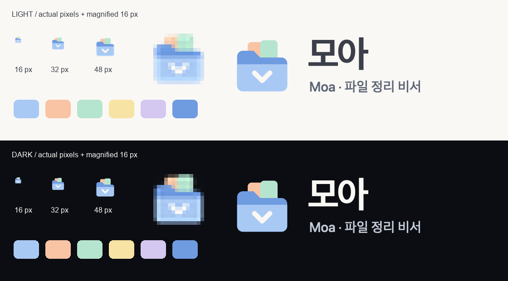
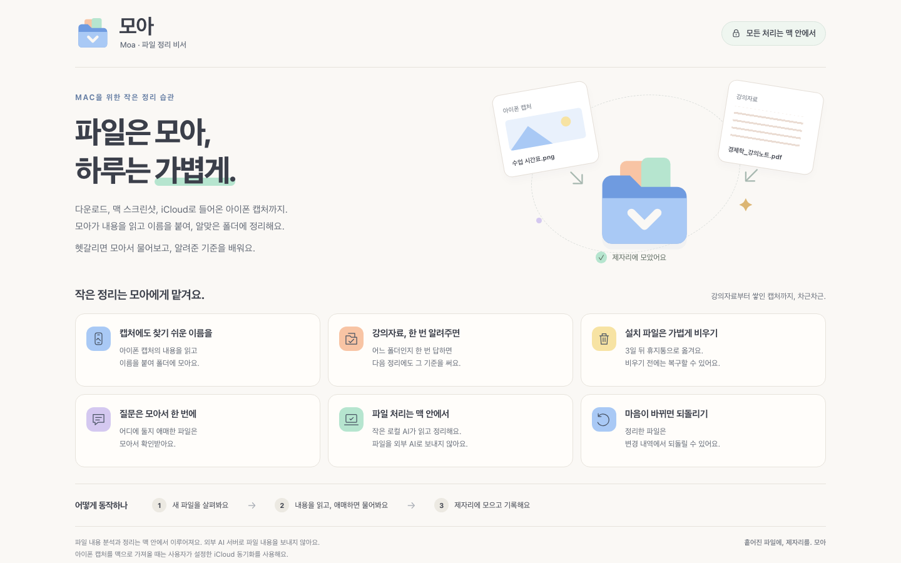

# 모아 브랜드

| 폴더 | 내용 |
|---|---|
| [`favicon/`](favicon/) | 파비콘 SVG·ICO, 16·32px, Apple 터치 아이콘 180px, PWA 아이콘 192·512px |
| [`logo/`](logo/) | 심볼(`logo-mark.svg`), 가로형 로고(밝은·어두운 배경, 외곽선 버전), 2배 PNG |
| [`service/`](service/) | 서비스 설명 글(`service_description.md`)과 소개 페이지 시안(HTML, PNG) |

**슬로건:** 파일은 모아, 하루는 가볍게.

**색:** 하늘 `#A9C9F5` · 복숭아 `#F8C4A4` · 민트 `#B6E5CF` · 버터 `#F7E3A3` · 라벤더 `#D4C8F0` · 글자 `#3B3F4A` · 배경 `#FAF8F5`

웹(`web/dist`)에는 파비콘과 PWA 아이콘이 적용돼 있습니다.

