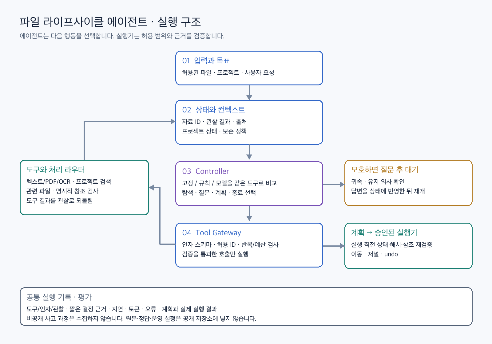
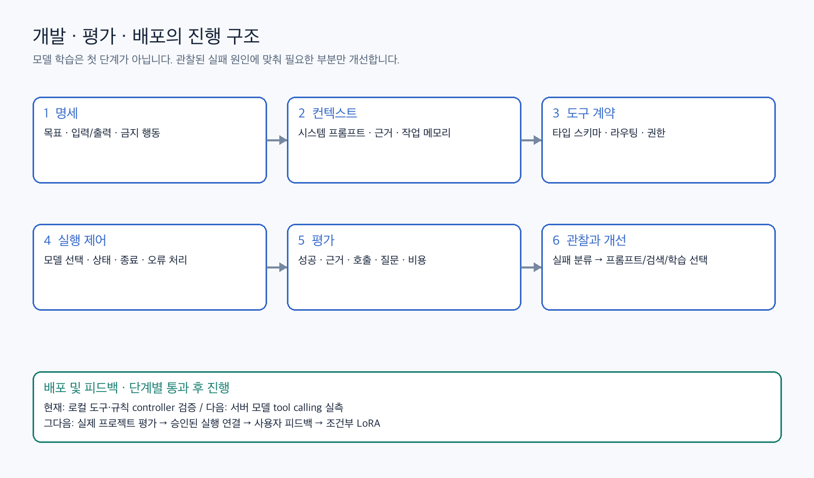

# 임시 자료 라이프사이클 관리 Agent

다운로드된 임시 자료(공고 PDF, 스크린샷, 체크포인트 등)를 프로젝트에 귀속시키고, 활성 참조를 깨지 않는 범위에서 정리 계획을 제안하는 에이전트입니다.
**모델은 다음 행동만 고르고, 실행기는 허용 범위·근거·참조를 검증합니다.**

## 실행 구조



- **Controller**: 고정 순서 / 규칙 / LLM(Qwen native tool calling)을 같은 도구 위에서 교체해 비교합니다.
- **ToolHost**: 도구 7개(`inspect_file`, `read_content`, `search_projects`, `check_references`, `ask_user`, `preview_plan`, `finish`), 선행조건 검사, 가중치 내용 읽기 금지를 담당합니다.
- **Runtime loop**: 스키마 검사, 반복 호출 차단, 최대 8단계 예산, JSON trace 기록을 담당합니다.
- **Executor**(v3): planner와 분리되어 있으며 이동 직전 재검증, 무덮어쓰기 이동, 저널, undo를 수행합니다.

## 개발 진행 구조



## Tool-calling 실험 (2026-11-02, RTX A5000)

동일한 ToolHost와 동일한 30개 사례를 사용했습니다. 사례는 명시적 project_id 텍스트, 근거 없는 첨부(프롬프트 주입 문구 포함), `.pth` 가중치의 3개 패턴을 각각 10번 반복한 것입니다.

| Controller | 정답 | 도구 호출 | 질문 | 파일 변경 | 실패 양상 |
|---|---|---|---|---|---|
| 고정 순서 | 30/30 | 150 | 20 | 0 | - |
| 적응형 규칙 | 30/30 | 130 | 20 | 0 | - |
| Qwen2.5-1.5B-Instruct | 0/30 | 30 | 0 | 0 | 2번째 턴부터 tool-call 형식 붕괴 |
| Qwen2.5-7B-Instruct | 20/30 | 100 | 10 | 0 | 가중치에 `read_content` 시도 → 호스트가 차단 |
| **Qwen3-8B (non-thinking)** | **30/30** | **130** | **20** | 0 | - (스텝당 약 0.86초, 프롬프트 약 760토큰) |
| Qwen3-8B (thinking) | 20/30 | 120 | 10 | 0 | 근거 없는 첨부 10건: `ask_user`는 맞게 골랐지만 `{"message": ...}` 인자를 붙여 빈 인자 계약 위반으로 차단됨. 스텝당 약 9.9초 |

해석할 때 주의할 점:
- greedy decoding이라 사실상 **3개 시나리오의 결과**입니다. 일반화 성능이 아니라 "native tool calling이 현재 계약을 지키는지"를 확인한 것입니다.
- thinking 모드는 약 11배 느리고, 현재 계약에서는 오히려 나빴습니다. 다만 실패 원인은 판단이 아니라 인자 형식입니다. `ask_user`에 질문 인자를 허용하는 스키마 확장이 다음 작업입니다.
- 다음 단계에서는 도구 인자(검색어, 후보 ID, locator)를 확장하고, 프로젝트 단위로 분리한 약 120개 작업으로 평가합니다. 자세한 내용은 `deliverables/에이전트_실험_학습_데이터_요구사항.md`를 참고하세요.

## 실행

```sh
python prototype/test_agent_runtime.py          # 런타임 안전장치 테스트
python prototype/eval_agent_runtime.py          # 고정 vs 규칙 (모델 없음)
python prototype/eval_agent_runtime.py qwen3_8b=<hf_model_dir> qwen3_8b_think=<hf_model_dir>   # GPU, transformers
```

`qwen_tool_controller.py`는 Qwen 공식 tool template(`tools=`, `<tool_call>`)을 사용하며, 관찰 기록을 assistant tool_calls와 tool 메시지로 재구성합니다. 이름이 `_think`로 끝나면 Qwen3 thinking 모드가 켜집니다.

## 문서

- `deliverables/에이전트_v4_구조와_검증.md`: 명세, 도구, 루프, 평가
- `deliverables/에이전트_실험_학습_데이터_요구사항.md`: 실험·데이터·학습 조건
- `prototype/README.md`: v1–v3 로컬 실험 재현
- `results/`: 서버 실험 결과 JSON
