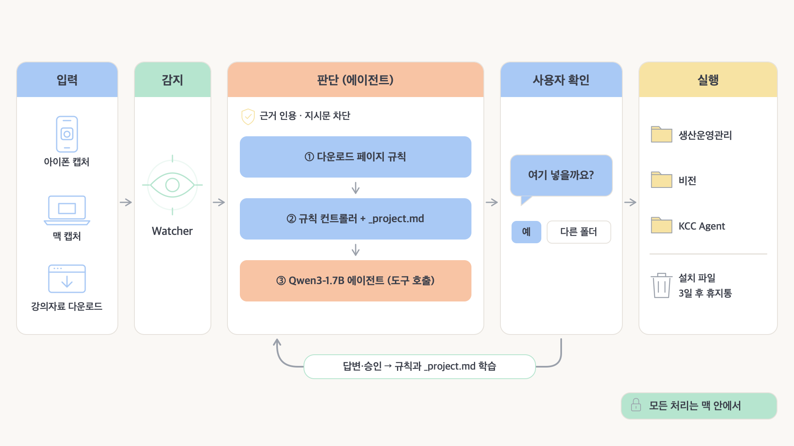
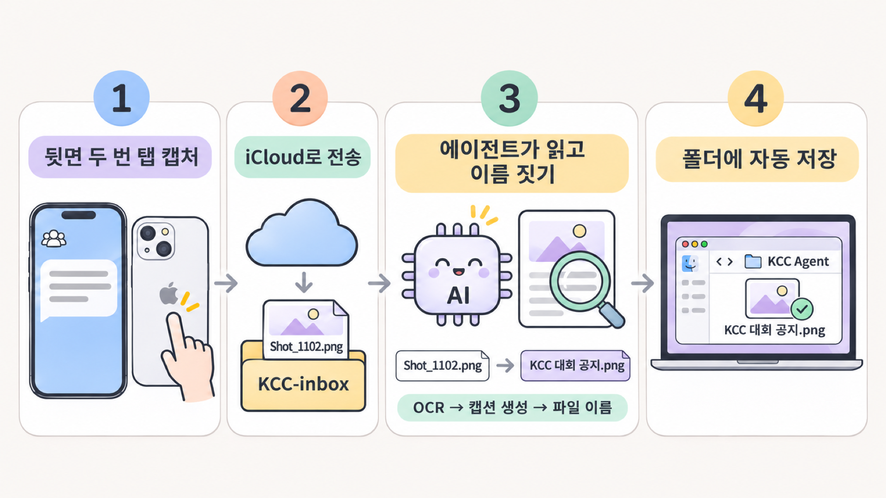
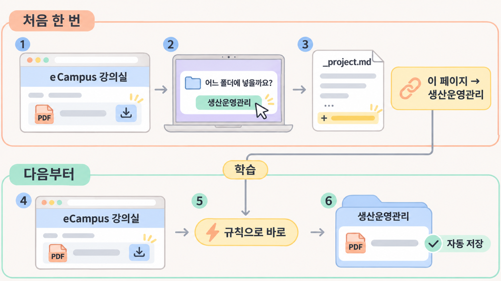
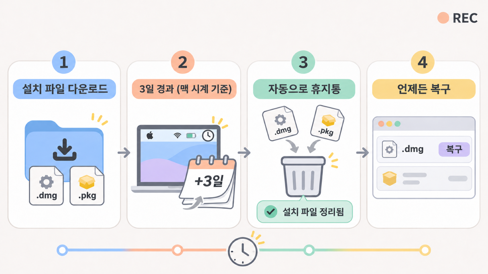

# KCC 파일 라이프사이클 에이전트 · 모아

> 다운로드한 강의자료와 아이폰·맥 캡처를 맞는 폴더에 알아서 정리하는 **맥 로컬 에이전트**와,
> 그 상태를 보고 결정을 내리는 **웹(모아)** 입니다.

## 🚀 간편 시작: Mac 웹앱 + iCloud Drive

최상위 **모아 시작.command**를 더블클릭 → 모아에서 **iCloud Drive 연결** → 이후 **Dock의 모아**로 실행합니다. Python과 실행기 설정은 자동으로 진행합니다. 자세한 내용은 [설치와 동작 범위](web/local/README.md)를 보세요.

## 구성

| 폴더 | 내용 |
|---|---|
| 📂 [`file-lifecycle-agent/`](file-lifecycle-agent/) | 맥에서 도는 에이전트: 파일 판단(Qwen3-1.7B + 규칙), 계획 검증, 승인 실행과 되돌리기 |
| 🌐 [`web/`](web/) | 모아 웹, Django API, EC2 배포 소스 |
| 🔌 [`web/bridge/`](web/bridge/) | 맥 에이전트 상태를 API로 보내고 웹의 명령을 전달하는 브리지 |
| 🖥️ [`web/local/`](web/local/) | Mac 웹앱 설치와 실행 (`모아 시작.command`) |

## 시연

| 아이폰 캡처 → 자동 이름 → 폴더 | eCampus 자료 → 한 번 답하면 자동 | 설치 파일 → 3일 뒤 휴지통 |
|---|---|---|
|  |  |  |

## 웹 실제 데이터 모드

웹은 기본적으로 실제 데이터 모드로 열립니다.

- **로그인하면:** 대시보드, 파일 검색, 폴더, 분류 대기, 보관 대기, Mac 휴지통, 명령 기록이 계정별 에이전트 상태를 사용합니다.
- **명령 전달:** 답변, 이동 승인, 유지, 되돌리기, 휴지통 복구는 브리지 명령 API로 Mac에 전달되고, 상태는 5초마다 갱신됩니다.
- **시연 모드:** 상단의 **시연 모드 보기**를 누르면 브라우저 예시 데이터로 따로 볼 수 있습니다.
- **Mac에서만 바꿀 수 있는 것:** 실제 모드에서는 폴더 설명이 읽기 전용입니다. 지침, 감시, 모델, 정책 변경은 Mac에서 합니다.
- 브리지를 업데이트한 뒤에는 브리지를 다시 실행해야 파일별 프로젝트 정보가 전송됩니다.

## 문서

| 문서 | 내용 |
|---|---|
| [`LOCAL_SETUP.md`](LOCAL_SETUP.md) | Mac에서 클론 후 웹·API·에이전트·브리지 실행 |
| [`file-lifecycle-agent/README.md`](file-lifecycle-agent/README.md) | 에이전트 동작 방식, 실행 옵션, 결과 요약 |
| [`file-lifecycle-agent/docs/local_api.md`](file-lifecycle-agent/docs/local_api.md) | 맥 에이전트의 로컬 HTTP API (웹 연결용 엔드포인트·응답 형식) |
| [`web/INTEGRATION.md`](web/INTEGRATION.md) | 웹과 로컬 실행기 연결 계약 및 미구현 항목 |
| [`file-lifecycle-agent/docs/experiments.md`](file-lifecycle-agent/docs/experiments.md) | 모델·가드·학습 실험 기록 |
